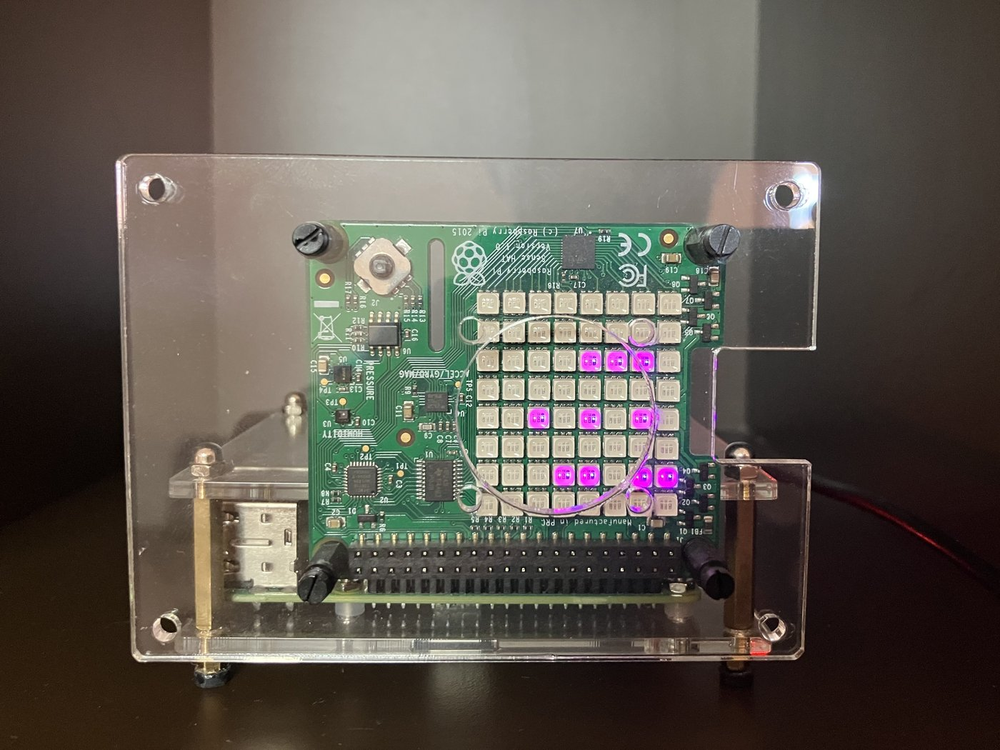
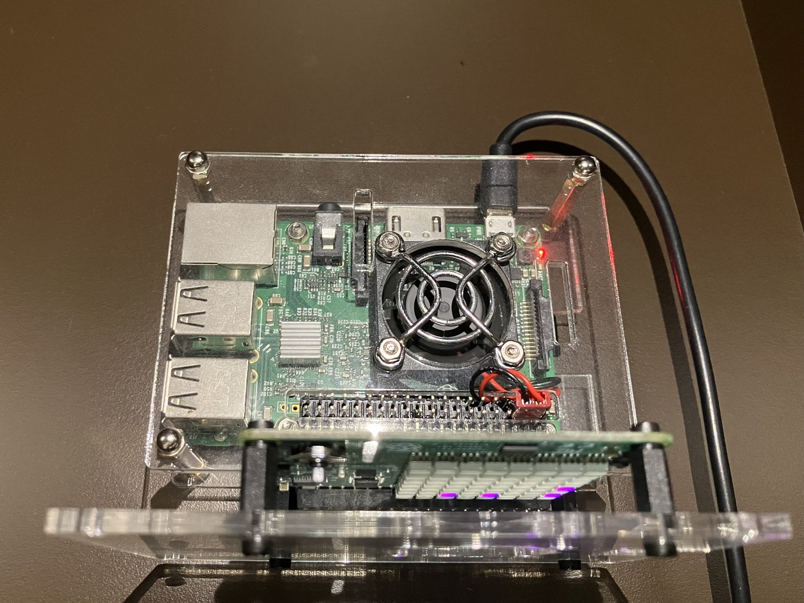
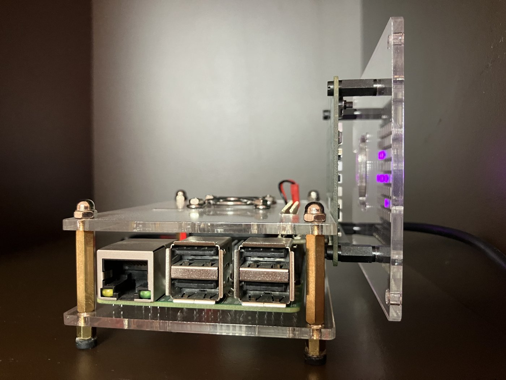

# Rellotge binari i monitor de temperatura i humitat amb Raspberry Pi 3B+ i Sense HAT: calibratge, historial SQLite i còpia de seguretat al USB

Aquesta guia documenta el procés que vaig seguir per muntar un rellotge binari i una petita
estació de temperatura i humitat casolana amb una Raspberry Pi 3B+ i un Sense HAT. Inclou el
calibratge dels sensors, un historial a [SQLite](https://www.sqlite.org) i una còpia de
seguretat automàtica en una memòria USB.

<p align="center">
  
</p>

## Motivació i context

El meu amic Patxiii em va regalar la Raspberry Pi i el Sense HAT perquè hi jugués. Primer hi
vaig muntar un emulador amb RetroPie, però hi jugava poc. Després vaig buscar possibles
projectes i el de l'estació meteorològica em va agradar, perquè em semblava viable i útil.
Mentre l'anava fent, l'he modificat i adaptat a la meva situació.

Al principi volia mesurar la temperatura i la humitat de casa amb el Sense HAT, però
sospitava que les lectures no eren fiables. Vaig investigar-ho i vaig confirmar que:

- És un problema **conegut**: el Sense HAT llegeix per sobre de la temperatura real perquè
  rep la calor de la CPU i dels LEDs.
- La fórmula que fa servir la gent per corregir-ho depèn d'un `FACTOR` que varia molt
  segons el muntatge (de 1,5 a 5,4 en les fonts que vaig trobar), així que **no es pot
  copiar de cap lloc**: cal calibrar el sensor contra una referència pròpia.
- El sensor d'humitat (HTS221) té una precisió de ±3,5 % HR entre el 20 i el 80 %
  (±5 % en tot el rang), així que no té sentit buscar més precisió que aquesta.

Volia que el conjunt fos senzill i robust: només biblioteca estàndard de Python, cap
servidor de base de dades i res que pogués deixar el sistema penjat si alguna cosa fallava.

## ⚠️ Avís important

- **Els valors de calibratge (`-3,6 °C` i `-5,7` punts d'humitat) són per al meu muntatge.**
  No els copiïs: calibra el teu sensor (vegeu el pas 2).
- La humitat és una **estimació amb una incertesa d'uns ±3,5 a ±5 punts**, no una mesura de
  laboratori.
- Una línia errònia a `/etc/fstab` pot impedir que el sistema arrenqui. Fes-ne una còpia
  abans i fes servir `nofail` (pas 4).
- Els scripts i les unitats de systemd fan servir l'usuari `pi` i la carpeta `/home/pi`. El
  meu usuari real era un altre i l'he substituït per privacitat. Adapta'ls al teu.

## Equip utilitzat

- Raspberry Pi 3B+, un ventilador d'electrònica genèric de 5 V i un Sense HAT.
- Un extensor GPIO de 40 pins en forma de L (*GPIO extension header*), peus de silicona,
  separadors i plaques de metacrilat, comprats a AliExpress (vegeu el muntatge).
- Raspberry Pi OS (Debian) en una microSD, amb el paquet `sense-hat` instal·lat i l'I2C activat.
- Una memòria USB d'uns 7 GB formatada en ext4, per a les còpies.
- Dos sensors d'una estació meteorològica domèstica, **només per calibrar**: el A (sensor
  remot, amb només el sensor i les piles) i el B (la base, amb pantalla i electrònica pròpia).

```text
.
├── monitor.py              # rellotge, lectura, pantalla i guardat a la base de dades
├── backup_historic.py      # còpia incremental de la base de dades al USB
├── systemd/                # servei del monitor, servei de la còpia i temporitzador
└── images/                 # fotos del muntatge
```

Les bases de dades (`*.db`) no s'inclouen: són dades del dispositiu. Els scripts estan
comentats, així que aquí només explico el que no es veu al codi.

## Muntatge físic

<p align="center">
  
  
</p>

- **El Sense HAT està en vertical i separat de la Pi.** Vaig comprar un extensor GPIO de
  40 pins en forma de L per poder-lo col·locar així i no perdre els connectors del
  ventilador de la Raspberry Pi. Si en vols buscar un, prova «Raspberry Pi GPIO extension
  header 40 pin 90 degree». Així el HAT queda lluny de la CPU i del ventilador, que són la
  font principal de l'error de temperatura. A més, la Raspberry no va dins d'una caixa
  tancada, per ventilar-la millor. Per això `monitor.py` no compensa amb la temperatura de
  la CPU i només aplica un desplaçament constant.
- **El Sense HAT queda girat 180°** a causa d'aquest tipus de muntatge. Per això el codi
  gira la pantalla (`ROTATION = 180` al principi de `monitor.py`) i el text i el rellotge es
  veuen en la posició correcta. Si el teu HAT queda col·locat d'una altra manera, canvia
  aquest valor (0, 90, 180 o 270).
- **Rellotge binari en lloc de mostrar sempre les dades.** Vaig valorar mostrar sempre la
  temperatura i la humitat, però tenia por que la calor dels LEDs escalfés els sensors, i a
  més tenir aquesta dada sempre a la vista aportava poc. Així va sorgir la idea del rellotge
  binari (hores, minuts i segons), que fa servir la part de la matriu més allunyada possible
  dels sensors, en violeta i amb poca llum. Cada 15 minuts la pantalla mostra una frase
  personalitzada per cridar l'atenció, perquè hi hagi temps de veure la temperatura i la
  humitat, que es mostraran a continuació, i després torna al rellotge.
- **Placa de metacrilat davant del Sense HAT**, amb separadors i un forat sobre els LEDs
  perquè es refredin més de pressa.
- **El davant dels sensors està tapat** perquè els corrents d'aire no donin lectures
  estranyes.
- **Peus de silicona** a la base per evitar sorolls i vibracions.
- **Tot el conjunt va dins d'un prestatge**, per tenir un entorn casolà controlat on poder
  calibrar-lo. El kit està pensat perquè es pugui moure a qualsevol altre lloc interior.

> **Què no he mesurat:** no he comparat amb i sense la placa ni he mesurat quant millora la
> refrigeració dels LEDs o l'estabilitat de les lectures. Són decisions de muntatge, no
> resultats mesurats. El calibratge depèn del muntatge: si el canvies, cal repetir-lo.

## Pas 1 — El monitor

`monitor.py` s'executa com a servei:

- Cada **15 minuts en punt** llegeix el sensor i mostra una frase, la temperatura i la
  humitat. El color indica si el valor és dins del rang de confort (verd), per sobre
  (vermell) o per sota (blau).
- La frase depèn de la **sensació tèrmica** (fórmula australiana de temperatura aparent,
  sense vent), no de la temperatura seca. Les frases del repositori són d'exemple.
- La resta del temps mostra el rellotge binari.

```bash
sudo cp systemd/monitor.service /etc/systemd/system/
sudo systemctl daemon-reload
sudo systemctl enable --now monitor.service
```

El servei té `Restart=always`: si el procés acaba, systemd el torna a aixecar al cap de
10 segons.

### Com es llegeix el rellotge binari

El rellotge fa servir tres files de la matriu de LEDs. Cada LED encès val 1 i cada LED
apagat val 0, i se sumen els valors dels LEDs encesos:

- **Fila de dalt: hores.** 5 LEDs.
- **Fila del mig: minuts.** 6 LEDs.
- **Fila de baix: segons.** 6 LEDs.

Això és tal com es veu amb la pantalla ja girada 180° (vegeu el muntatge físic). A cada
fila, el LED de més a la dreta val 2⁰ = 1 i cada LED següent cap a l'esquerra val el
doble que l'anterior (potències de 2):

| | 2⁵ | 2⁴ | 2³ | 2² | 2¹ | 2⁰ |
|---|---|---|---|---|---|---|
| **Valor** | 32 | 16 | 8 | 4 | 2 | 1 |

Les hores només tenen 5 LEDs, perquè arriben com a màxim a 23 i els LEDs valen de 16 a 1
(2⁴ és l'últim). Els minuts i els segons en tenen 6, perquè arriben a 59 i necessiten el 32
(2⁵ és l'últim).

Exemple: les **14:37:05** es veurien així (● = LED encès, ○ = LED apagat, – = no existeix):

| | 32 | 16 | 8 | 4 | 2 | 1 | Suma |
|---|---|---|---|---|---|---|---|
| **Hores** | – | ○ | ● | ● | ● | ○ | 8 + 4 + 2 = **14** |
| **Minuts** | ● | ○ | ○ | ● | ○ | ● | 32 + 4 + 1 = **37** |
| **Segons** | ○ | ○ | ○ | ● | ○ | ● | 4 + 1 = **5** |

## Pas 2 — Calibrar la temperatura i la humitat

### 2.1 Primera estimació amb un termòmetre de pistola

Vaig mesurar les parets, el sostre i la base del moble amb un termòmetre d'infrarojos i ho
vaig comparar amb el Sense HAT. La diferència era d'uns **2,5 °C**, així que el primer
`TEMP_OFFSET` va ser `-2,5`. És una aproximació, perquè aquest termòmetre mesura la
temperatura de **superfície**, no la de l'aire.

### 2.2 Calibratge amb dos sensors de referència

Vaig col·locar els dos sensors a 20-30 cm de la Pi (A a la mateixa alçada, B 10 cm més
avall) i vaig prendre 7 lectures en moments diferents:

| # | A (°C / %) | B (°C / %) | Raspberry (°C / %) |
|---|---|---|---|
| 1 | 25,2 / 60 | 24,8 / 54 | 26,0 / 63 |
| 2 | 24,9 / 51 | 25,5 / 47 | 26,3 / 54 |
| 3 | 25,0 / 51 | 25,5 / 46 | 26,4 / 54 |
| 4 | 23,8 / 46 | 24,2 / 42 | 25,0 / 52 |
| 5 | 24,0 / 46 | 24,4 / 42 | 25,2 / 51 |
| 6 | 24,3 / 53 | 25,0 / 47 | 25,6 / 58 |
| 7 | 24,4 / 53 | 24,9 / 48 | 25,3 / 58 |

Diferència mitjana de la Raspberry respecte de cada referència:

| Referència | Temperatura | Humitat |
|---|---|---|
| Només A | +1,17 °C | +4,3 punts |
| Mitjana A i B | +0,98 °C | +6,7 punts |
| Només B | +0,79 °C | +9,1 punts |

> **Un detall que vaig haver de tenir en compte:** les lectures de la Raspberry ja portaven
> aplicat el `-2,5` de la primera estimació. Per tant, la diferència de temperatura
> **s'havia de sumar** a aquest valor, no substituir-lo.

Els dos sensors de referència no coincideixen del tot (B marca de mitjana 0,4 °C més i uns
5 punts menys d'humitat que A). Com que A només té el sensor i les piles, vaig suposar que
s'escalfa menys per si mateix i vaig ponderar la referència **70 % A i 30 % B**. És un
criteri meu, no una dada demostrada. El resultat:

```python
TEMP_OFFSET = -3.6   # °C
HUM_OFFSET = -5.7    # punts de %HR
```

> **Limitacions:** són només 7 lectures, en un rang estret (24-26 °C i 45-58 % HR), i
> assumeixo que l'error és un desplaçament constant. A humitats més altes (65-70 %) la
> correcció és una extrapolació que no puc comprovar sense una referència nova. Per veure
> tendències serveix igualment. Per afinar-ho es podria fer la prova de la sal (un pot
> hermètic amb sal humida dona uns 75 % HR) i ajustar també el pendent.

## Pas 3 — Historial a SQLite

Vaig escollir **SQLite** en lloc de MariaDB: només calen 96 mostres al dia, és un sol
fitxer, no necessita cap servei i el mòdul `sqlite3` ja ve amb Python. MariaDB només tindria
sentit per consultar la base de dades des d'altres equips de la xarxa.

La taula `mostres` guarda data (`AAAA-MM-DD`), hora (`HH:MM`), temperatura i humitat
**ja corregides** (les de la pantalla) i sensació tèrmica. `UNIQUE (data, hora)` evita
duplicar mostres si el servei es reinicia dins del mateix quart d'hora.

```bash
# Últimes files
sqlite3 -header -column historic.db "SELECT * FROM mostres ORDER BY id DESC LIMIT 5;"

# Resum per dia
sqlite3 -header -column historic.db "
SELECT data,
       ROUND(AVG(temperatura), 1) AS t_mitja,
       MIN(temperatura)           AS t_min,
       MAX(temperatura)           AS t_max,
       ROUND(AVG(humitat))        AS hr_mitjana,
       COUNT(*)                   AS mostres
FROM mostres
GROUP BY data
ORDER BY data;"
```

## Pas 4 — Còpia de seguretat al USB

### 4.1 Muntar el USB de forma permanent

Amb el USB connectat, `lsblk -f` el mostra com a `sda1` (ext4). Crea el punt de muntatge,
fes una còpia de `fstab` i afegeix-hi el USB (substitueix `<UUID>` pel de `lsblk -f`):

```bash
sudo mkdir -p /mnt/backup
sudo cp /etc/fstab /etc/fstab.bak
echo 'UUID=<UUID> /mnt/backup ext4 defaults,nofail,x-systemd.device-timeout=5 0 0' | sudo tee -a /etc/fstab
sudo systemctl daemon-reload
sudo mount -a
findmnt /mnt/backup
sudo chown pi:pi /mnt/backup
```

`nofail` és important: si el USB no hi és, la Raspberry arrenca igualment.

### 4.2 Còpia incremental cada dia a les 00:00

`backup_historic.py` manté **un únic fitxer** al USB (`historic_backup.db`) i cada nit hi
afegeix les files noves, sense esborrar mai res. Abans comprova que el USB està realment
muntat (si no, escriuria a la SD) i que la còpia existent és íntegra.

```bash
sudo cp systemd/backup-historic.service systemd/backup-historic.timer /etc/systemd/system/
sudo systemctl daemon-reload
sudo systemctl enable --now backup-historic.timer
systemctl list-timers backup-historic.timer
```

`Persistent=true` fa que, si la Raspberry estava apagada a les 00:00, la còpia s'executi
en arrencar. Si es perd la base de dades original, es pot restaurar copiant el fitxer de
còpia a `historic.db` (només ho he provat amb dades de prova).

### 4.3 Còpia de la configuració

Per poder refer el sistema si falla la microSD, vaig copiar al USB els scripts, les unitats
de systemd i el `fstab`:

```bash
mkdir -p /mnt/backup/config
cp monitor.py backup_historic.py /mnt/backup/config/
cp /etc/systemd/system/monitor.service /etc/systemd/system/backup-historic.service /etc/systemd/system/backup-historic.timer /mnt/backup/config/
cp /etc/fstab /mnt/backup/config/fstab
```

És una instantània: s'ha de repetir si es canvien els scripts o els offsets.

## Verificació

**Primera mostra guardada** (valors ja corregits):

```text
id  data        hora   temperatura  humitat  sensacio_termica
--  ----------  -----  -----------  -------  ----------------
1   2026-11-02  18:00  20.6         68       22.0
```

**Còpia de seguretat** (primera execució manual i segona a través de systemd; la segona
vegada ja no hi ha files noves, que és el comportament esperat):

```text
[backup] OK: 1 files noves afegides; total a la copia: 1; a l'original: 1
[backup] OK: 0 files noves afegides; total a la copia: 1; a l'original: 1
```

Per comprovar que el temporitzador s'executa sol i que no hi ha serveis fallits:

```bash
journalctl -u backup-historic.service -n 5 --no-pager
systemctl list-units --failed
```

## Resultat

La Raspberry mostra un rellotge binari i, cada 15 minuts, la temperatura i la humitat
corregides; guarda cada mostra a `historic.db` i copia les noves al USB cada nit.

## Limitacions conegudes

- **Un sol fitxer de còpia:** si el USB el corromp, no hi ha cap versió anterior. Una còpia
  manual periòdica a un altre equip ho compensaria.
- **La còpia no propaga canvis:** si s'esborren files de l'original, a la còpia es queden.
- **Errors silenciosos:** si el monitor no pot guardar, només ho avisa pel registre; si el
  backup falla, el servei surt com a `failed` però no hi ha cap notificació.
- **Els offsets només són al codi:** si es canvien, l'historial anterior manté els valors
  que tenia; convé apuntar la data del canvi.
- **Hora local sense zona horària:** en el canvi d'hora d'octubre, la segona vegada que es
  repeteix una hora s'ignora (unes 4 mostres menys a l'any).

## Reconeixement

El disseny del projecte i del muntatge és meu. He fet servir Claude (Anthropic) com a
suport per fer els scripts i configuracions, a més de guiar-me durant el calibratge, 
la base de dades i la còpia de seguretat. Totes les comandes i decisions finals les he
executat jo al meu dispositiu.

He fet això com a exercici d'aprenentatge i ho publico per ajudar altres persones que els pugui
interessar fer aquest projecte.

## Referències

- [Sense HAT Temperature Correction — Initial State](https://github.com/initialstate/wunderground-sensehat/wiki/Part-3.-Sense-HAT-Temperature-Correction)
- [Accurate temperature reading from Raspberry Pi Sense HAT — Yet Another Arduino Blog](http://yaab-arduino.blogspot.com/2016/08/accurate-temperature-reading-sensehat.html)
- [Raspberry Pi Accessory: Sense HAT — Review (element14)](https://community.element14.com/products/roadtest/rv/roadtest_reviews/166/raspberry_pi_accesso_1)
- [Sense Hat Rubbish temperature accuracy — Raspberry Pi Forums](https://www.raspberrypi.org/forums/viewtopic.php?t=152498)
- [HTS221 — fitxa tècnica (STMicroelectronics)](https://st.com/resource/en/datasheet/hts221.pdf)
- [SQLite](https://www.sqlite.org)
